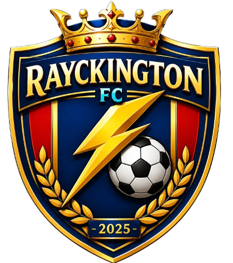
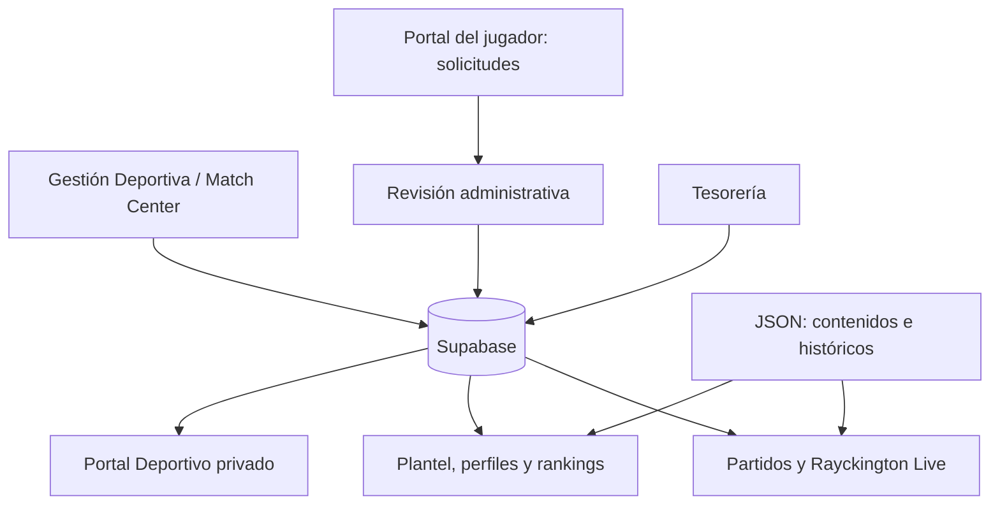

<div align="center">



# RAYCKINGTON F.C.

### Sitio oficial · Plataforma deportiva y administrativa

**Nacimos para competir, jugamos para ganar.**

[](https://rayckingtonfc.cl)


Una plataforma creada para conectar **la historia, los partidos, los jugadores y la gestión del club** en un solo lugar.

[🌐 Visitar sitio](https://rayckingtonfc.cl) · [⚽ Partidos](https://rayckingtonfc.cl/partidos.html) · [👥 Plantel](https://rayckingtonfc.cl/plantel.html) · [📊 Rankings](https://rayckingtonfc.cl/plantel.html#ranking-plantel)

</div>

---

## 📌 Sobre el proyecto

**Rayckington F.C.** es un club de fútbol fundado en **2025**, con una identidad construida alrededor de la competencia, el compromiso y la organización deportiva.

Este repositorio contiene su sitio oficial y las interfaces de una plataforma de gestión que reúne información pública del club y herramientas privadas para **jugadores** y **administración**.

La web comenzó como una página informativa y evolucionó hacia un sistema integrado con **Supabase**, donde se gestionan partidos, estadísticas, alineaciones, cuentas y Tesorería. Los archivos **JSON** siguen utilizándose para determinados contenidos e información histórica: no se eliminan por el hecho de contar con una base de datos.

> [!IMPORTANT]
> **Rayckington Live** es un seguimiento escrito del partido (marcador, cronómetro y jugadas); **no es una transmisión de video**.

## 🧭 Contenido

- [Funciones principales](#-funciones-principales)
- [Rayckington Live](#-rayckington-live)
- [Cómo funciona la información](#-cómo-funciona-la-información)
- [Tecnologías](#-tecnologías)
- [Estructura del proyecto](#-estructura-del-proyecto)
- [Ejecución local](#-ejecución-local)
- [Publicación y despliegue](#-publicación-y-despliegue)
- [Seguridad y permisos](#-seguridad-y-permisos)
- [Flujo operativo de un partido](#-flujo-operativo-de-un-partido)
- [Estado y próximos pasos](#-estado-y-próximos-pasos)
- [Identidad del club](#-identidad-del-club)

---

## 🚀 Funciones principales

### 🌍 Sitio público

| Sección | Funcionalidad |
| --- | --- |
| **Inicio** | Identidad del club, actualidad, patrocinadores y próximos encuentros. |
| **Nosotros** | Historia, información institucional y presentación del equipo. |
| **Plantel** | Jugadores y cuerpo técnico con fichas individuales. |
| **Rankings** | Goles, asistencias, minutos, partidos, MVP y vallas invictas, según los datos disponibles. |
| **Partidos** | Competiciones, calendario, resultados y tablas históricas. |
| **Perfil de jugador** | Información deportiva e historial estadístico. |
| **Noticias** | Publicaciones y novedades del club. |
| **Galería** | Fotografías y material visual. |
| **Contacto** | Información de contacto y vías de participación. |

### 👤 Portal Deportivo del jugador

- Acceso con cuenta mediante **Supabase Auth**.
- Vista personal de partidos, competiciones y estadísticas.
- Solicitud de estadísticas individuales de encuentros habilitados, sujetas a revisión administrativa.
- Consulta de solicitudes pendientes, aprobadas o rechazadas.
- Actualización de fotografía del perfil.
- Selección de **posición principal y secundaria por única vez**; los cambios posteriores corresponden a administración.
- Navegación hacia el portal de Tesorería.

**Regla histórica 2026:** los acumulados de las **Fechas 1 y 2 del Clausura** se mantienen como registros históricos. Los autorreportes nuevos comienzan desde la **Fecha 3**, únicamente cuando el encuentro está finalizado y habilitado. Los jugadores no aprueban sus propias estadísticas.

### 🧑‍💼 Gestión Deportiva

- Administración de temporadas, competiciones, equipos y encuentros.
- Configuración de fecha, jornada, rival, condición, estadio y estado de publicación.
- **Match Center:** cronómetro, marcador, estados del partido y registro de eventos.
- Gestión de convocados, titulares, suplentes y sustituciones.
- **Cancha táctica interactiva** con esquemas, distribución manual de puestos y guardado por encuentro.
- Filtro de jugadores por posición principal y secundaria, con opción de utilizar futbolistas fuera de posición.
- Preparación del cierre deportivo: minutos estimados, goles, asistencias, tarjetas y diferencias por revisar.
- Aprobación administrativa de estadísticas oficiales.

### 🧠 Pizarra táctica

Esquemas disponibles en la versión instalada:

`4-3-3` · `4-4-2` · `4-2-3-1` · `3-5-2` · `5-3-2` · `4-1-4-1` · `4-4-1-1`

El flujo está diseñado para **convocar primero**, elegir el **once titular** entre los convocados y visualizar el **banco de suplentes** por separado. La ubicación de los puestos puede ajustarse con mouse o pantalla táctil, sin alterar la identidad del jugador asignado.

### 💳 Tesorería y administración financiera

- Acceso privado para integrantes y responsables autorizados.
- Consulta de cuotas, mensualidades, pagos y estados de revisión.
- Envío de comprobantes de transferencia.
- Administración de pagos, egresos y seguimiento de deudas.
- Gestión de rifas, aportes, premios y entregas.
- Aprobación de pagos y sus cuotas mediante una operación transaccional protegida en Supabase.
- Navegación entre los módulos financiero y deportivo, manteniendo sus permisos independientes.

---

## 🔴 Rayckington Live

**Seguimiento público del encuentro**, integrado con los datos deportivos registrados desde Match Center.

| Estado del encuentro | Experiencia del visitante |
| --- | --- |
| **PROGRAMADO** | Previa: rival, fecha, hora y lugar. |
| **EN VIVO / ENTRETIEMPO** | Marcador, cronómetro, minuto a minuto, alineación y suplentes. |
| **FINALIZADO** | Resultado final y resumen de los acontecimientos registrados. |

**Eventos contemplados:** goles, asistencias vinculadas a jugadas, tarjetas y sustituciones. La vista consulta periódicamente las novedades, con una frecuencia prevista de **10 segundos**.

- La **formación se mantiene privada antes del inicio** del encuentro.
- La vista pública utiliza datos deportivos publicados y no requiere exponer información financiera ni identificadores privados de acceso.
- **Publicar un partido no lo pone en vivo**: la publicación y el inicio del cronómetro son acciones distintas.
- Los eventos anulados no deben mostrarse en el seguimiento.

> [!NOTE]
> La primera versión de Rayckington Live está **instalada**; su validación integral durante un encuentro oficial continúa pendiente. Un partido marcado como publicado puede mostrar su previa mientras siga programado.

**Vista pública:** [`seguimiento.html`](seguimiento.html) · **Calendario:** [`partidos.html`](partidos.html)

---

## 🔄 Cómo funciona la información



### Fuentes de datos

| Fuente | Uso principal |
| --- | --- |
| **Supabase Database** | Partidos, competiciones, estadísticas, convocatorias, cambios, perfiles vinculados, cuotas y pagos. |
| **Supabase Auth** | Inicio de sesión y vinculación de cuentas. |
| **Supabase Storage** | Archivos como fotografías y comprobantes, según sus políticas de acceso. |
| **JSON local** | Contenidos editoriales y datos históricos o de respaldo que siguen formando parte del sitio. |

Las estadísticas **históricas**, los datos **por partido** y las **solicitudes de jugadores** cumplen funciones distintas. Se deben conciliar sin duplicar participaciones, goles ni otros acumulados.

> **Importante:** finalizar un encuentro no convierte automáticamente cada dato sugerido en una estadística oficial. El administrador confirma las cifras antes de su publicación estadística.

---

## 🛠 Tecnologías

| Capa | Herramientas |
| --- | --- |
| Interfaz | HTML5, CSS3, JavaScript (módulos ES). |
| Componentes visuales | Bootstrap 5, Bootstrap Icons y CSS propio. |
| Datos estáticos | JSON. |
| Backend gestionado | Supabase (PostgreSQL, Auth, Storage y RPC). |
| Control de versiones | Git y GitHub / GitHub Desktop. |
| Alojamiento web | GitHub Pages. |
| Dominio | `rayckingtonfc.cl` mediante `CNAME`. |
| Diseño adaptable | Estilos responsive para escritorio, tablet y celular. |

**No se requiere un framework JavaScript ni un proceso de compilación** para ejecutar las páginas estáticas de este repositorio. Los módulos privados sí dependen de una instancia de Supabase configurada con su esquema, políticas y funciones.

## 🗂 Estructura del proyecto

```text
Pagina-RayckingtonFC/
├── index.html                 # Inicio
├── nosotros.html              # Historia e información institucional
├── plantel.html               # Plantel y rankings
├── jugador.html               # Perfil público individual
├── partidos.html              # Competiciones, calendario y resultados
├── seguimiento.html           # Rayckington Live (módulo agregado)
├── noticias.html
├── noticia.html
├── galeria.html
├── contacto.html
├── portal.html                # Portal privado de Tesorería
├── admin-tesoreria.html       # Administración financiera
├── portal-deportivo.html      # Portal privado del jugador
├── admin-deportivo.html       # Administración deportiva / Match Center
├── activar-cuenta.html        # Activación de cuenta
├── assets/
│   ├── css/
│   │   ├── responsive.css
│   │   ├── mobile-portales.css
│   │   ├── admin-deportivo.css
│   │   ├── profile-positions.css
│   │   ├── rankings-plantel.css
│   │   └── ...
│   ├── js/
│   │   ├── partidos.js
│   │   ├── rayck-live.js       # Seguimiento público (módulo agregado)
│   │   ├── admin-deportivo.js
│   │   ├── match-roster.js
│   │   ├── match-formation.js
│   │   ├── match-close.js
│   │   ├── portal-deportivo.js
│   │   ├── admin-tesoreria.js
│   │   └── ...
│   ├── data/                  # JSON editoriales y datos históricos
│   └── img/                   # Logos, escudos, fotos y galerías
├── CNAME                       # Dominio de GitHub Pages
├── robots.txt
├── sitemap.xml
└── README.MD
```

**Nota:** `seguimiento.html` y `rayck-live.js` corresponden al módulo Live instalado después del último ZIP de referencia. Los scripts de migración SQL se han gestionado en Supabase por separado; no se presupone que estén versionados en esta carpeta.

---

## 💻 Ejecución local

1. Clona o descarga el repositorio.
2. Abre la carpeta en **Visual Studio Code**.
3. Inicia **Live Server** desde `index.html`, o un servidor HTTP local equivalente.
4. Abre la dirección que indique el servidor. Ejemplo: `http://127.0.0.1:5500/`.

También puedes utilizar Python desde la raíz del proyecto:

```bash
python -m http.server 5500
```

> Evita abrir la web con `file://`: algunas solicitudes `fetch()` y los módulos JavaScript necesitan servirse por HTTP.

### Requisitos para los módulos privados

- Proyecto Supabase existente y accesible.
- Tablas, políticas RLS y funciones RPC requeridas por los módulos instalados.
- Cuentas autorizadas de jugadores y administradores.
- Buckets y permisos de Storage configurados donde corresponda.

El repositorio **no debe contener contraseñas, claves `service_role`, claves secretas ni respaldos de datos personales**. Una clave pública/anon de Supabase no sustituye las políticas de seguridad: la autorización debe aplicarse del lado de la base de datos y sus funciones.

## ☁️ Publicación y despliegue

El sitio se publica como web estática en **GitHub Pages** y utiliza el dominio:

**🌐 https://rayckingtonfc.cl**

Flujo de publicación recomendado:

1. Guardar una copia o **commit de respaldo** antes de cambios grandes.
2. Probar las modificaciones localmente, tanto en escritorio como en celular.
3. Revisar los archivos modificados en **GitHub Desktop**.
4. Hacer **Commit** y luego **Push origin**.
5. Verificar que GitHub Pages publique la versión nueva.
6. Si los estilos parecen antiguos, recargar con `Ctrl + Shift + R` y revisar la ruta del CSS en la consola.

**Importante:** actualizar CSS, HTML o JavaScript **no requiere SQL** salvo que una nueva funcionalidad introduzca cambios explícitos en la base de datos.

---

## 🔐 Seguridad y permisos

El sistema combina autenticación y **Row Level Security (RLS)** en Supabase.

| Perfil | Acceso esperado |
| --- | --- |
| **Visitante** | Contenido público, partidos publicados, plantel y estadísticas públicas. |
| **Jugador autenticado** | Su perfil, sus solicitudes de estadísticas y su información financiera autorizada. |
| **Administrador deportivo** | Gestión de partidos, convocatorias, eventos y estadísticas oficiales. |
| **Administrador autorizado** | Funciones de Tesorería conforme a las políticas de acceso del club. |

Reglas destacadas:

- Las solicitudes deportivas se revisan antes de convertirlas en estadísticas oficiales.
- Las solicitudes históricas anteriores al punto de inicio definido están restringidas.
- Los pagos nuevos enviados por jugadores deben comenzar **PENDIENTES**.
- La aprobación de un pago y sus cuotas está diseñada para ejecutarse conjuntamente.
- Las funciones privilegiadas deben comprobar permisos **dentro de Supabase**, no solo ocultar botones en el navegador.

> [!WARNING]
> Aunque se han revisado políticas y funciones críticas, la seguridad requiere **pruebas periódicas con diferentes roles**. No interpretes una interfaz funcional como una auditoría completa de todas las rutas de acceso.

---

## ⚽ Flujo operativo de un partido

1. **Crear el encuentro** en Gestión Deportiva, indicando competición, jornada, rival, fecha y lugar.
2. **Publicar la previa** cuando los datos estén confirmados. Marcar `publicado` no inicia el partido.
3. **Preparar la convocatoria** desde la lista tradicional.
4. **Definir el once y el banco** en la cancha táctica y guardar el esquema.
5. **Iniciar Match Center** cuando comience el encuentro.
6. **Registrar eventos**: goles, asistencias, tarjetas y sustituciones.
7. **Cerrar el encuentro** y preparar las estadísticas sugeridas.
8. **Revisar y confirmar** las fichas deportivas oficiales.
9. **Consultar la web pública** para verificar marcador, seguimiento, plantel, rankings y perfiles.

Las vistas que consultan Supabase obtienen los cambios guardados al refrescar o en sus ciclos de actualización; no todos los módulos funcionan con una suscripción de tiempo real.

---

## 🧪 Estado y próximos pasos

| Bloque | Estado |
| --- | --- |
| Página pública y secciones institucionales | ✅ Implementado |
| Portal Deportivo y Tesorería | ✅ Implementados y probados por el club |
| Gestión Deportiva / Match Center V4 | ✅ Implementado; continuar validación operativa |
| Cancha táctica, convocatoria y suplentes | ✅ Implementados y probados |
| Estadísticas históricas y rankings | ✅ Integrados; mantener revisión de consistencia |
| Adaptación móvil pública y privada | ✅ Instalación y pruebas visuales realizadas |
| Rayckington Live V1 | 🟡 Instalado; pendiente prueba integral en partido real |
| Auditoría completa de seguridad, roles y permisos | 🟡 Revisión continua |
| Administración sencilla de logos de rivales | 📋 Mejora futura |
| Recuperación/cambio de contraseña desde el portal | 📋 Mejora futura |

La prioridad operativa es **mantener estable la versión actual** y validar el seguimiento en vivo antes de introducir cambios importantes. Se conservan los archivos JSON históricos mientras sean necesarios para evitar pérdida o duplicación de datos.

---

## 🔴🔵🟡 Identidad del club

**Nombre:** Rayckington F.C.  
**Fundación:** 2025  
**Colores:** azul, rojo y amarillo  
**Lema:** *Nacimos para competir, jugamos para ganar.*  
**Sitio oficial:** [rayckingtonfc.cl](https://rayckingtonfc.cl)

<div align="center">

---

Desarrollo y mantenimiento web: **BlaCorp**  
**© 2026 Rayckington F.C.**

**NACIMOS PARA COMPETIR, JUGAMOS PARA GANAR.**

</div>
